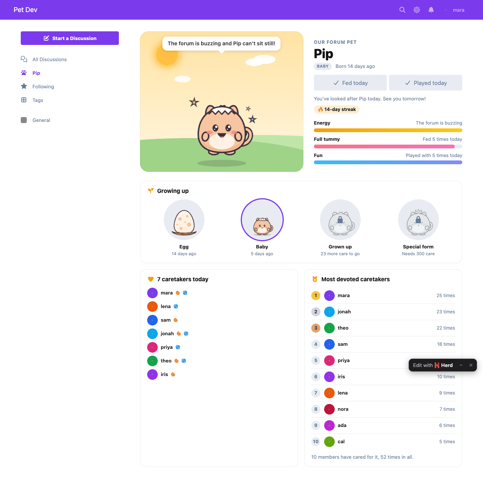
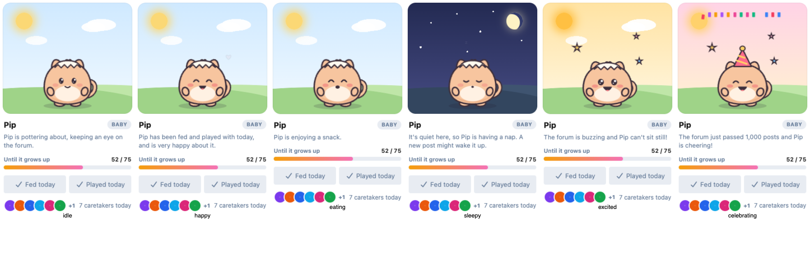

# Forum Pet

A shared mascot the whole community takes care of. It lives in your Flarum 2 forum's sidebar, follows the forum's mood, eats and plays with each member once a day, and grows from an egg into its special form as the community looks after it.

 [](https://packagist.org/packages/ernestdefoe/forum-pet)



- **A pet with moods.** Original animated art in three species (Dumpling, Sprout and Comet), each in three skins. It blinks, breathes, hops and naps. Its mood follows the forum: excited when people are posting, sleepy (with a starry night sky) when it's quiet, happy once it's been fed and played with.
- **Feed and Play, once a day.** Every member can feed it and play with it once a day. Each has its own little animation, and the pet thanks you by name. The server decides "once a day", so a double tap or a second tab can't count twice.
- **Caretakers today.** The sidebar card and the pet's page show who has looked after it today, and the page has the most devoted caretakers since it hatched, plus your own streak.
- **It grows up.** Egg, then baby (still wearing a bit of its shell), then grown up, then a special form with a glowing aura. Every feed and play counts toward the next stage, and the admin chooses how much care each stage takes.
- **Evolution day is a celebration.** When the pet hatches or grows, it celebrates all day: party hat, confetti, a banner on the discussion list, and a special thank-you for the member whose care tipped it over.
- **It cheers the forum on.** When the forum passes a round number of posts (1,000, 10,000…), the pet celebrates that too.
- **Holiday hats.** With [Festoon](https://github.com/ernestdefoe/festoon) installed, the pet wears the day's hat: a Santa hat, a witch's hat, bunny ears, a top hat and more.
- **Its own page** at `/pet`, with a big scene, its energy, full tummy and fun meters, the growing-up journey and the caretakers.
- **On phones** a small pet sits in the corner (out of the composer's way) and opens its card.
- **Make it yours.** Name it, pick a species and skin from live previews, or upload your own art for each mood.
- **Light and quick.** The pet's state is worked out at most once a minute and cached, so a page view costs a cache read plus one small lookup for members. The art and the page load after the page is drawn. Animations stop for readers who ask for reduced motion.


- **Permissions** to see the pet (guests by default) and to feed and play with it (members by default).
- **GDPR**: with Flarum's GDPR extension, the days a member cared for the pet are part of their data export and are removed on erasure.

## Install

```sh
composer require ernestdefoe/forum-pet
```

## Update

```sh
composer update ernestdefoe/forum-pet
php flarum migrate
php flarum cache:clear
```

## Links

- [Packagist](https://packagist.org/packages/ernestdefoe/forum-pet)
- [GitHub](https://github.com/ernestdefoe/forum-pet)
- [Buy me a coffee](https://buymeacoffee.com/ernestdefoe)
